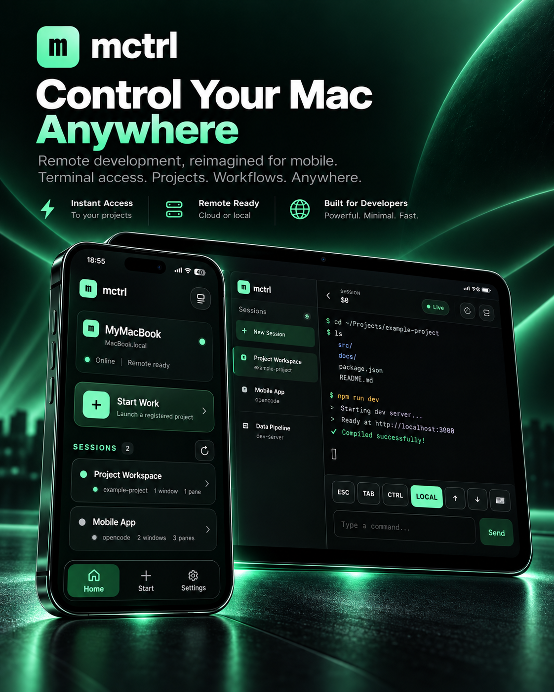
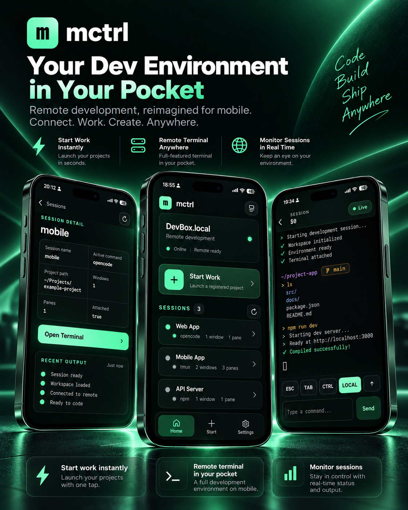
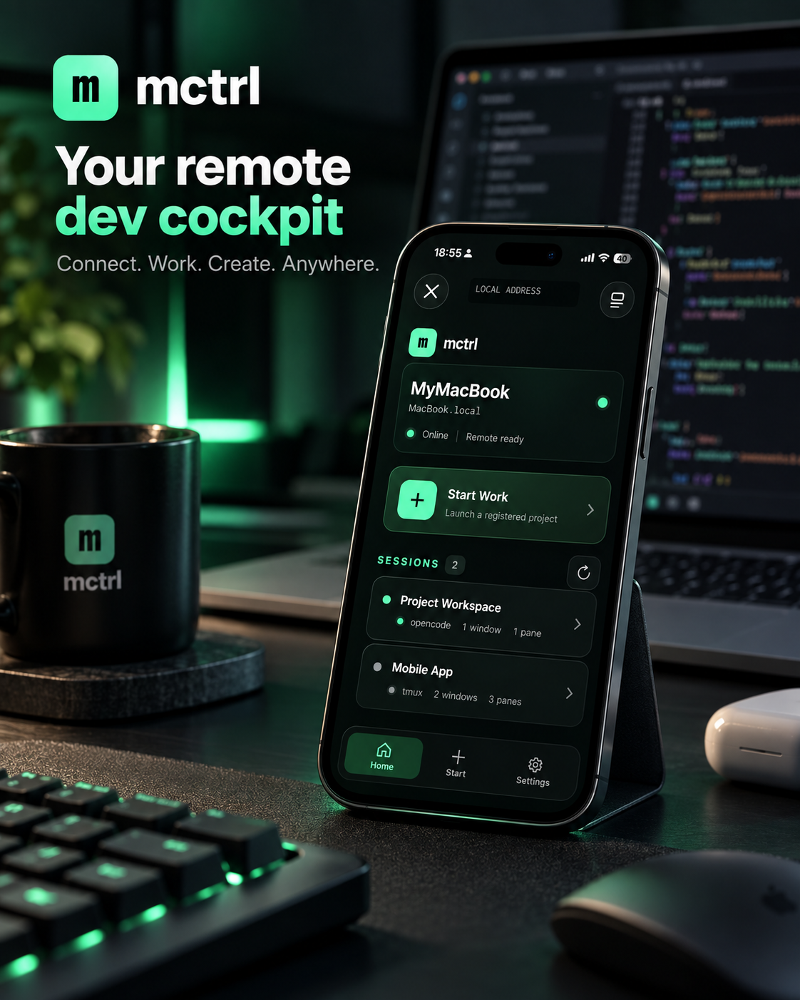

<div align="center">

# mctrl

### Your Dev Environment in Your Pocket

**Connect. Work. Create. Anywhere.**

[](https://github.com/liamamilin/mctrl/actions/workflows/ci.yml)
[](go.mod)
[](https://github.com/liamamilin/mctrl)
[](LICENSE)

mctrl is a mobile control surface for terminal work running on your Mac.
Observe existing tmux sessions, intervene when needed, and launch durable
Managed Work from your iPhone—without moving execution into the cloud.

<p align="center">
  
</p>

<p align="center">
  
  
</p>

</div>

---

## What is mctrl?

mctrl is **not** an SSH client, cloud IDE, or remote desktop.

It is a focused control plane for a Mac that is already running your development
environment:

- **Start on the Mac** with `mctrl here`, then continue the same session on your phone.
- **Resume** an existing tmux session from your phone.
- **Observe** recent terminal output without taking over the desktop.
- **Intervene** through a real terminal when a task needs attention.
- **Launch** registered Projects through Shell, Codex, or OpenCode runners.
- **Continue working** after the browser closes, the phone locks, or the daemon
  restarts.

> The computer does the work. The phone starts, observes, and intervenes.

## Highlights

| | |
|---|---|
| **Observe & Resume** | Discover real tmux Sessions, active commands, working directories, windows, panes, and recent output. |
| **Desktop → phone → desktop** | `mctrl here` prepares a session in your current directory; the phone provides a command to return to that same session. |
| **Managed Work** | Open a registered Project interactively or submit a task while `mctrl-runner` owns the real child process. |
| **Durable by design** | Work survives phone disconnects and daemon restarts; tmux remains the source of Session truth. |
| **Terminal escalation** | `LOCAL` provides a readable interactive viewport. `FULL` fits, zooms, and pans the complete desktop-sized pane. |
| **Safe prompting** | Structured Prompt actions are idempotent. Raw terminal input is never replayed after uncertain delivery. |
| **Power protection** | Configurable macOS power assertions protect active Work without promising to wake an unreachable Mac. |
| **Pairing that stays useful** | A browser stays paired for 30 days. Safari and the installed PWA can share one device record through a short-lived browser link. |
| **Mac pairing launcher** | A lightweight `Mctrl Pair.app` opens a QR Pair Console—no terminal required after initial setup. |

## Requirements

- macOS on Apple Silicon or Intel
- macOS logged in and reachable from the phone
- Go **1.27.1**
- Node.js **22+**
- tmux **3.7c** or compatible
- iPhone Safari or installed PWA

## Quick Start

### 1. Build and verify

```sh
git clone git@github.com:liamamilin/mctrl.git
cd mctrl
make release-check
```

`make release-check` rebuilds the PWA, embeds frontend assets, runs Go tests,
`go vet`, the race detector, TypeScript checks, CLI smoke tests, the macOS pairing
launcher check, and binary checksums.

### 2. Initialize mctrl

Loopback-only mode is the default:

```sh
./bin/mctrl setup
```

For a phone on a private trusted LAN:

```sh
./bin/mctrl setup --lan
```

The setup command installs a macOS LaunchAgent. After login, launchd starts and
maintains the daemon.

### 3. Pair the iPhone

Build the lightweight Finder launcher:

```sh
make mac-launcher
open 'dist/Mctrl Pair.app'
```

The launcher opens a Mac-only Pair Console with:

- a QR code;
- a copyable one-time pairing code;
- a manual pairing address for devices that cannot scan.

The equivalent CLI is:

```sh
./bin/mctrl pair --open
```

In Trusted-LAN mode, the QR and phone address prefer the Mac's Bonjour name,
such as `http://My-Mac.local:17681`, so a DHCP IP change does not change the saved
phone entry. Keep both devices on the same reachable Wi-Fi. The Pair Console
also shows the current IP under **If the phone address does not open**; use it
with the same pairing code if the network cannot resolve `.local` names.

When moving from an old numeric-IP bookmark or Home Screen icon, pair once at
the hostname address and add that address to the Home Screen again. Browser
credentials belong to each origin. Changing the Mac's local name changes this
entry too. An explicitly configured public URL or listener address is respected.

### 4. Install the short Mac command

```sh
./scripts/install-cli.sh
```

This links `~/.local/bin/mctrl` to the built CLI. The installer preserves any
different file already at that location and leaves your shell configuration
unchanged. If the command is unavailable, add `~/.local/bin` to your `PATH`.
For the current terminal:

```sh
export PATH="$HOME/.local/bin:$PATH"
```

Keep the same line in your shell startup file to make it persistent. Rebuilding
the repository updates the binary used by the link.

## Choose Your Workflow

### Start on the Mac, continue on the phone

1. Open a new WezTerm tab (or another terminal), enter your project directory,
   and run:

   ```sh
   cd /path/to/project
   mctrl here
   ```

2. In the shell that opens, start your usual tool, for example `codex` or
   `opencode`. `mctrl here` creates or resumes the directory's tmux Session;
   no separate tmux command or Project registration is needed.
3. On the phone, open **Home**, select the Session, read its output, and tap
   **Open Terminal** to continue interacting. You can leave the Mac attached,
   or press **Ctrl+B, then D** there to detach while keeping the work running.
4. Back on the Mac, run `mctrl here` from the original project directory again.
   Alternatively, copy the command from **Session detail → Continue on your
   Mac** and run it in a new terminal tab. Both reconnect to the existing Session.

The helper uses the daemon's recorded tmux connection and selected profile.
An already running process in an ordinary terminal must first be restarted
inside a tmux Session to follow this route. These Sessions are external tmux
Sessions; they do not create Managed Work records or Runner-owned power
assertions. The Mac still needs to stay awake and reachable.

### Start an interactive session from the phone

1. Tap **Start → Register a Project** if the directory is not registered yet.
   Enter a display name and an existing Mac directory's absolute path (or `~`
   for the Mac user's home), tap **Register Project**, then **Start in this
   directory**. The launch form returns with the new Project selected.
2. Choose the Project and a Runner. **Shell** opens in the displayed directory;
   **Codex/OpenCode → Open & interact** opens the tool there directly.
3. Tap **Start Work** to enter Terminal. Interact, leave the App, and return
   to the same Session later. The last successfully selected Project is remembered.

Selecting the Project sets the starting directory, so a separate `cd` is only
needed when changing directories during the session. You can also register from
the Mac:

```sh
mctrl project add /path/to/project --name 'My Project'
mctrl project list
```

### Submit a task from the phone and review it later

1. Choose a registered Project and **Codex/OpenCode → Run a task**.
2. Enter the task text and tap **Start Work**. The Session output page opens.
3. Leave the App and return to review output and process exit facts. A process
   exiting successfully does not establish that the task achieved its goal.

Codex/OpenCode must already have working authentication and provider settings
on the Mac. Runner detection confirms installation, not account availability.

### Copy output, change directories, and return

Home offers **Continue last session** when its live identity still matches. The
Session page puts recent output before folded process details and termination.

In Terminal, tap **Copy** to select output or copy the current path. **Use
selection in draft** inserts at the draft caret or replaces its selection while
preserving surrounding text; **Prepare cd command** quotes a selected directory
for a supported Shell. Review the draft, tap **Insert**, then press **⏎** when
ready. Insert preserves text and does not
append Return. Multiline insertion requires observed program paste support.
On HTTP, native text selection remains available when clipboard access fails.
Preview refresh preserves selected text and older output until **Show latest
output** is tapped. Returning to the App refreshes session facts immediately.

Closing the App or detaching leaves the Session running. **Session detail →
End this session → Close Session** terminates it and its processes. Unregistering
a Project removes a future launch target and does not close its Sessions.
If Work loses its Session, review it in **Settings → Work needing attention**;
confirmed lost Work can be archived while retaining its original history.

## Everyday CLI

```sh
mctrl status                 # daemon, transport, Sessions, Projects, devices
mctrl doctor                 # local diagnostics
mctrl pair                   # print a one-time phone Pair URL and QR
mctrl pair --open            # open the Mac Pair Console
mctrl here                   # create/resume a phone-accessible shell here
mctrl project list           # list registered Projects
mctrl devices                # show active and revoked device audit records
mctrl restart                # restart only the daemon
mctrl uninstall              # stop mctrl without deleting arbitrary tmux Sessions
```

To return to a specific Session, use the full `mctrl resume` command copied from
the phone's **Continue on your Mac** section.

## Version Isolation

The stable release and the next development line are isolated at both Git and
runtime levels:

```sh
mctrl profile                         # show the active V1 paths
mctrl --profile v2 profile            # inspect the V2 paths
mctrl --profile v2 setup --lan        # initialize V2 on port 17682
mctrl --profile v2 status
mctrl --profile v2 pair
```

V1 keeps `~/.mctrl`, its existing launchd service, cookies, Pair app, and tmux
behavior. V2 uses `~/.mctrl-v2`, port `17682`, a separate launchd service,
cookies, tmux socket, and `Mctrl V2 Pair.app`. V2 never writes to V1 state by
default. See [`VERSIONING.md`](VERSIONING.md) for cutover, rollback, and
side-by-side development.

## Transport Profiles

### Trusted-LAN HTTP

Zero external dependency. Intended only for a private, trusted network.

> **Warning:** plain HTTP provides no end-to-end confidentiality. A malicious
> or actively monitored LAN may observe or tamper with traffic.

### TLS-Terminated HTTPS/WSS

Use a trusted TLS endpoint such as Tailscale Serve or a user-controlled reverse
proxy:

```sh
mctrl setup \
  --transport tls_terminated \
  --public-url https://mctrl.example.internal
```

The public URL must be the exact browser-facing origin.

## Architecture at a Glance

```text
iPhone Safari / installed PWA
              │
       HTTPS / WSS or Trusted-LAN HTTP
              │
        mctrl daemon (Go)
        ├── pairing + device auth
        ├── REST + terminal WebSocket bridge
        ├── Project + Runner registry
        ├── Work lifecycle + recovery journal
        ├── power assertions
        └── tmux adapter
                  │
          durable tmux Sessions
                  │
             mctrl-runner
                  │
        Shell / Codex / OpenCode
```

The daemon is a control plane. `mctrl-runner` owns the Work child process, and
tmux owns Session persistence.

## Security Model

mctrl grants a paired phone highly privileged terminal access as the current
macOS user. The implementation includes:

- short-lived, one-time pairing tokens;
- salted credential and Session hashes;
- 30-day browser Sessions;
- strict Origin and CSRF validation for browser mutations;
- WebSocket revocation;
- active device records plus collapsed revoked history;
- two-minute, single-use browser-link tokens for Safari/PWA linking;
- no arbitrary `/execute` endpoint;
- no automatic replay of raw terminal input or uncertain Prompts.

Read [`SECURITY.md`](SECURITY.md) and
[`TRANSPORT_SECURITY.md`](TRANSPORT_SECURITY.md) before deployment.

## Development

```sh
make build          # rebuild PWA, embed assets, then build V1 binaries
make build PROFILE=v2  # build isolated V2 binaries under bin/v2
make mac-launcher PROFILE=v2  # build Mctrl V2 Pair.app
make test           # Go tests + vet + strict TypeScript
make test-race      # race detector, including real tmux integration
make test-browser   # Chromium/WebKit regression (install browser runtimes first)
make release-check  # complete deterministic V1 release gate
```

Frontend development:

```sh
cd web
npm ci
npm run dev
```

Documentation:

- [`DEVELOPMENT.md`](DEVELOPMENT.md)
- [`CLI_SPEC.md`](CLI_SPEC.md)
- [`docs/usage-flow-audit.md`](docs/usage-flow-audit.md)
- [`ARCHITECTURE.md`](ARCHITECTURE.md)
- [`PRODUCT.md`](PRODUCT.md)
- [`API.md`](API.md)
- [`WEBSOCKET.md`](WEBSOCKET.md)
- [`TEST_PLAN.md`](TEST_PLAN.md)
- [`TROUBLESHOOTING.md`](TROUBLESHOOTING.md)
- [`VALIDATION.md`](VALIDATION.md)
- [`VERSIONING.md`](VERSIONING.md)

## Repository Layout

```text
cmd/mctrl/             daemon and CLI
cmd/mctrl-runner/      Managed Work process owner
internal/api/          REST, WebSocket, static PWA serving
internal/auth/         pairing, browser Sessions, device linking
internal/config/       validated configuration
internal/project/      Project registry
internal/runner/       Shell/Codex/OpenCode runner registry
internal/tmux/         tmux lifecycle adapter
internal/work/         durable Work records and recovery
web/                   Preact + TypeScript PWA
packaging/macos/       macOS pairing launcher assets
scripts/               build and release scripts
```

## Current Status

`1.0.0` · V1 stable baseline

The real-iPhone Trusted-LAN path has been exercised. All three workflows above
are implemented. Workflow validation passed `make release-check` and
48 Chromium/WebKit tests, covering desktop continuation, mobile launch/input,
recovery, durability, reconnect and Prompt uncertainty. Lost Work can be reviewed
and archived in Settings without inventing an exit result or blocking its Project
indefinitely. Stable-hostname pairing passed four additional Chromium/WebKit
checks. Detailed evidence and dates are in [`VALIDATION.md`](VALIDATION.md).

Final TLS/WSS deployment, fresh physical-iPhone copy/keyboard/IME checks, and
authenticated Codex/OpenCode provider integration remain release gates. The
2026-10-09 provider probes were blocked by the configured Codex model/account
combination and OpenCode Go subscription requirements; see `VALIDATION.md`.

## License

[MIT](LICENSE) © 2026 liamamilin
